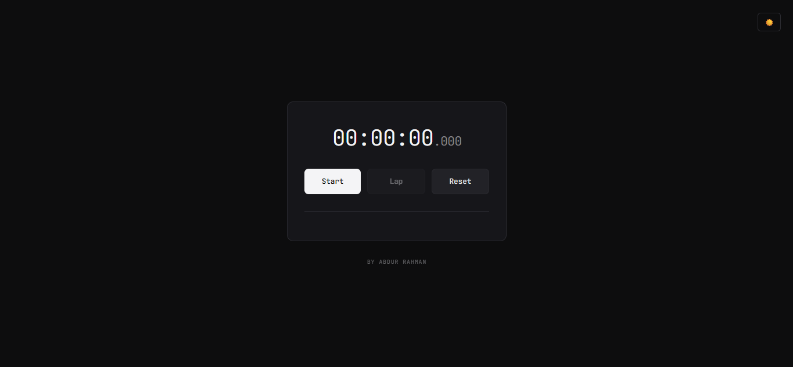
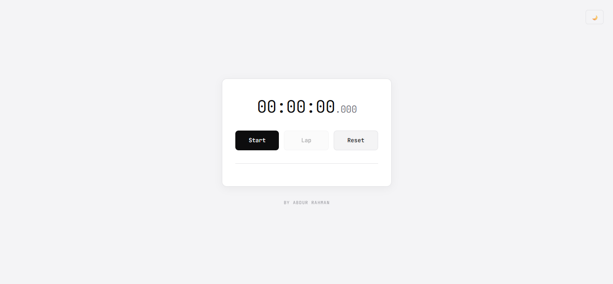
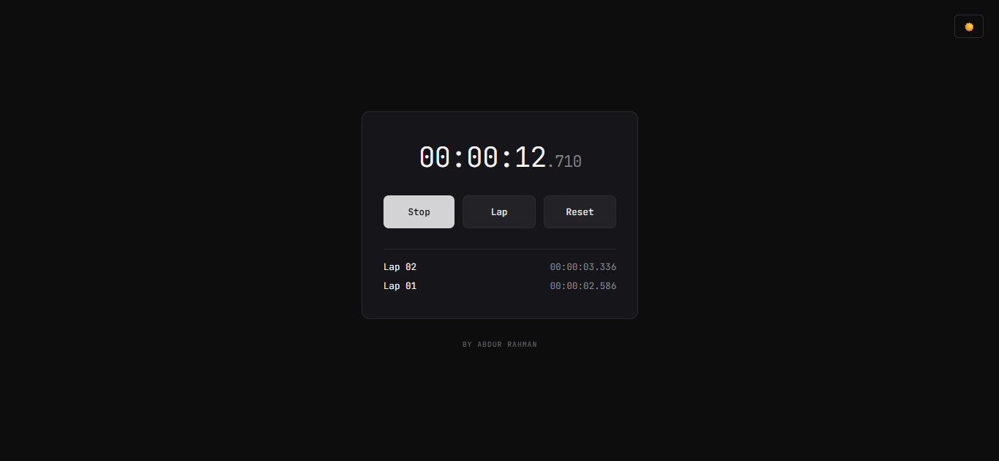
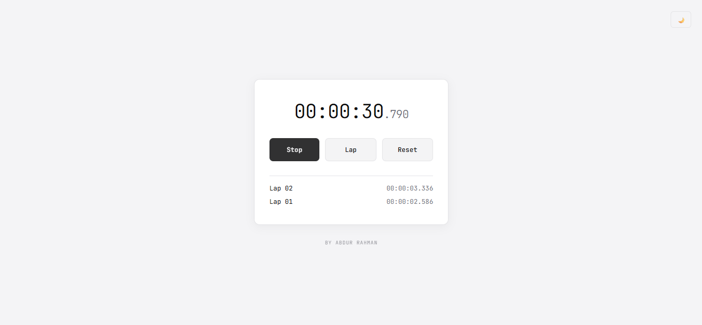

# Minimalist Stopwatch

A browser-based stopwatch built with **HTML, CSS, and vanilla JavaScript**. The interface displays elapsed time and supports starting, pausing, recording laps, resetting, and switching the theme.

### Stopwatch in Dark mode

### Stopwatch in Light mode

### Stopwatch in Dark mode

### Stopwatch in Light mode

## Features

- Start and pause timing
- Record lap times
- Reset the elapsed time and laps
- Light and dark themes
- Responsive, minimalist interface

## Run locally

Open `Stopwatch/index.html` in a browser. Keep the `Stopwatch/assets/` folder alongside the page.

## Built with

- HTML5
- CSS3
- Vanilla JavaScript

## Screenshots

| Light theme | Dark theme |
| --- | --- |
|  |  |
